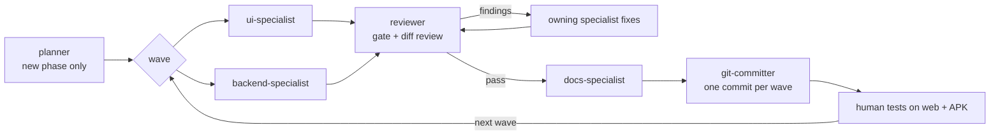

# Tripvisor

Tripvisor is a universal Expo app for planning trips across iOS, Android, and web from one codebase. It combines Supabase for auth/data, Google Places for search and live place details, and a route optimizer that splits trips across days.

## Current status

- Phase 3 in progress
- Core app structure, auth, trip CRUD, place search, place details, and optimization code are present
- End-to-end cloud setup still depends on real Supabase and Google Maps credentials

## Stack

- Expo SDK 52 + Expo Router
- React Native + React Native Web
- TypeScript
- Supabase (Postgres, Auth, Edge Functions)
- Google Maps Platform (Places API New, Routes API, Maps JS / native SDKs)
- TanStack Query

## Project structure

- `app/`: Expo Router screens
- `src/`: shared app code, components, API wrappers, theme, optimizer
- `supabase/`: SQL migrations and Edge Functions
- `docs/`: architecture, feature docs, review notes, ADRs
- `plan.md`: roadmap and delivery status

## Local setup

1. Install dependencies:

```bash
npm install
```

2. Fill in client env vars in `.env`:

```env
EXPO_PUBLIC_SUPABASE_URL=
EXPO_PUBLIC_SUPABASE_ANON_KEY=
EXPO_PUBLIC_GOOGLE_MAPS_WEB_KEY=
```

3. Initialize and link Supabase:

```bash
npx supabase init
npx supabase link --project-ref <your-project-ref>
npx supabase db push
```

4. Deploy edge functions and set secrets:

```bash
npx supabase functions deploy places-autocomplete place-details directions-polyline distance-matrix optimize-trip
npx supabase secrets set GOOGLE_MAPS_SERVER_KEY=...
npx supabase secrets set ALLOWED_ORIGINS=http://localhost:8081,https://your-host.com
```

5. Run the app:

```bash
npm run web
```

## Native notes

- Expo Go is not supported because the project uses `react-native-maps`
- Development builds are configured through `eas.json`
- Native Google Maps SDK keys still need to be set in `app.json`

## Built with Claude Code

Tripvisor is built with [Claude Code](https://claude.com/claude-code), Anthropic's agentic coding tool. Product direction, priorities and testing come from a human. The code, tests, migrations and docs are written by Claude agents working in a fixed loop. Commits made by the agents carry a `Co-Authored-By: Claude` trailer.

### The agent team

The main Claude Code session acts as the **orchestrator**. It never owns a file area itself. It splits work, writes briefs and routes results between specialist sub-agents, each defined in [`.claude/agents/`](./.claude/agents):

| Agent | Owns | Never touches |
|---|---|---|
| `planner` | Breaks a new phase into waves and steps in [`docs/v2/BUILD-LOG.md`](./docs/v2/BUILD-LOG.md), writes ADRs in [`docs/adr/`](./docs/adr) | Code, tests |
| `ui-specialist` | `app/`, `src/components`, `src/hooks`, `src/theme`, `app.json` / EAS / web config, plus its own component tests | Edge Functions, SQL, `src/api`, `src/sync` |
| `backend-specialist` | Supabase migrations and RLS, Deno Edge Functions, `src/api`, `src/sync`, the optimizer, plus its own unit tests | UI, docs |
| `reviewer` | Read-only. Runs the verification gate and reviews the diff, then names which agent fixes each finding | Any file |
| `docs-specialist` | BUILD-LOG status, `docs/v2/`, `docs/features/`, plan status | Code, tests, migrations |
| `git-committer` | Explicit-path staging, a secret scan, Conventional Commits, fast-forward push | History rewrites, force pushes |

All agents run on Claude Opus. The planner, specialists and reviewer use the highest reasoning effort, and the committer the lowest. A seventh `test-specialist` was retired (`.md.disabled`): each specialist now tests its own code.

### The wave loop

Each phase is planned as a series of **waves**. A wave is a set of steps whose files don't overlap, so the specialists can work in parallel without conflicts.



1. **Plan.** For a new phase, the `planner` writes waves with step ids (e.g. `Y3.2`), file ownership, risks and acceptance checks into the BUILD-LOG.
2. **Build in parallel.** The orchestrator gives the UI and backend specialists one complete brief each: step ids, file paths and acceptance checks, so they don't have to re-explore the codebase. Each specialist checks its own work (`tsc` plus the Jest tests it touched) before returning.
3. **Gate and review.** The `reviewer` runs the gate: the `tsc` error count must not rise above the recorded baseline, Jest must pass, `sync:validate` must pass, and the web export must build when config changed. It also reads the diff for broken golden paths, RLS gaps, Google ToS violations, cross-platform breakage and accessibility. Findings go back to the agent that owns the file.
4. **Document.** The `docs-specialist` updates the BUILD-LOG and feature docs in one pass so the docs match what shipped.
5. **Commit.** The `git-committer` makes one Conventional Commit per wave, naming the step ids and gate numbers, and pushes.
6. **Human QA.** No agent runs smoke tests. Each wave ends with a short "what to try" list, and the human tests it on web and on a local Android APK. Bugs found there become the next brief.

Small one-file fixes skip the planner: the orchestrator makes the change directly and the reviewer checks it.

### Larger sweeps

For quality passes, the same roles are fanned out. For example, the "60-agent sweep" (`9c0f544`) used 30 read-only bug hunters (174 findings) and then 15 fixers working on separate files, for 73 bug fixes in one verified commit.

### Memory and guardrails

- [`CLAUDE.md`](./CLAUDE.md) holds the project rules every session loads: stack, product vision, conventions, roles and the don'ts (no global installs, no remote `db reset`, no hardcoded keys, no force-push).
- Agents keep small durable notes in [`.claude/agent-memory/`](./.claude/agent-memory), such as commit policies and repo quirks. They are not activity logs; `git log` is the source of truth.
- Hard constraints are enforced in review: Google HTTP keys never reach the client, Google Place data is never persisted beyond `google_place_id` and coordinates, RLS is on every child table, and only free tiers are used.

## Docs

- [plan.md](./plan.md)
- [docs/architecture.md](./docs/architecture.md)
- [docs/features/overview.md](./docs/features/overview.md)
