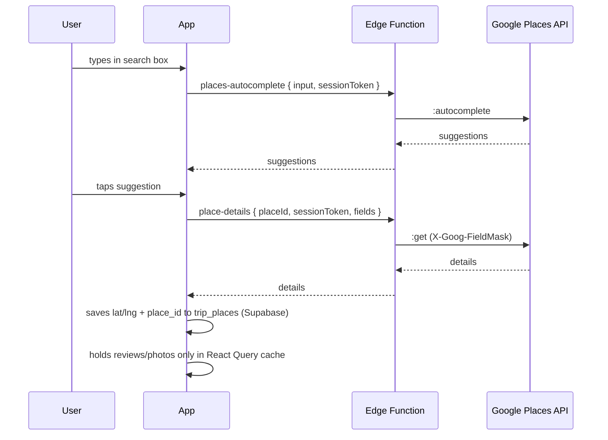
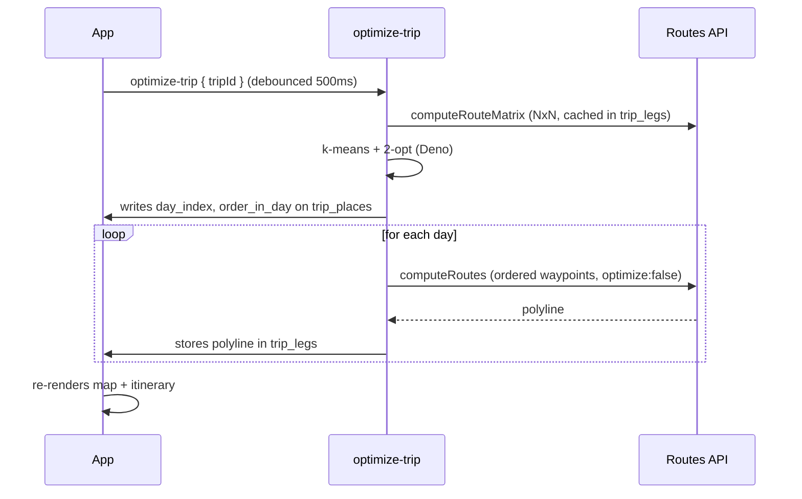

# Architecture

## Platforms & deploy

- **Native (iOS + Android)**: Expo SDK 52+ + React Native 0.76 via **EAS Build** + **EAS Update** (OTA). Requires `expo-dev-client` — **Expo Go not supported** due to `react-native-maps`.
- **Web**: `expo export --platform web` → static bundle → **Cloudflare Pages** or Vercel.
- **One codebase**: `app/` (Expo Router) + `src/` (shared). Platform-specific files use `.native.tsx` / `.web.tsx`.

## Backend

- Supabase project: Postgres + Auth + Edge Functions.
- Tables: `trips`, `trip_days`, `trip_places`, `trip_legs`, `trip_expenses`, `trip_collaborators`, `trip_accommodations`. See `supabase/migrations/`.
- **RLS on every table**; child tables scoped via `user_can_access_trip()` helper (Phase 21) — previously scoped directly via `trips.user_id`.

## Data model additions (Phase 20)

### `trips.total_budget`

New nullable column `total_budget numeric` added in migration `0010_trip_budget_categories.sql`. Represents the user's overall financial budget for the trip (not per-km). No unit enforcement — currency is inherited from `trips.currency`. The existing `cost_per_km` column is retained for backwards compatibility but deprecated via `COMMENT ON COLUMN`.

### `trip_expenses` table

Tracks categorized estimated and actual expenses for a trip.

| Column | Type | Notes |
|---|---|---|
| `id` | `uuid pk` | default `gen_random_uuid()` |
| `trip_id` | `uuid fk trips` | cascade on delete |
| `category` | `text` | CHECK IN (`accommodation`, `food`, `transport`, `shopping`, `activities`, `other`) |
| `kind` | `text` | CHECK IN (`estimated`, `actual`) |
| `amount` | `numeric` | CHECK `amount >= 0` |
| `label` | `text null` | optional user description |
| `day_index` | `int null` | links to a specific trip day; null means trip-level |
| `created_at` | `timestamptz` | default `now()` |

**RLS**: four policies (select / insert / update / delete) all scoped via `trip_id IN (SELECT id FROM trips WHERE user_id = auth.uid())`.

**Client API** (`src/api/trip-expenses.ts`): Zod schema + types; `useTripExpenses(tripId)`, `useCreateTripExpense()`, `useUpdateTripExpense()`, `useDeleteTripExpense()`, `useTripExpenseRollup(tripId)` (derived — no extra network request; returns `{ byCategory, totalEstimated, totalActual, budget, remaining, hasBudget }`). `useUpdateTripBudget(tripId)` in `src/api/trips.ts`. Query keys live in the shared `src/api/_keys.ts` leaf module.

**UI**: shipped Phase 21 — `BudgetCard`, `BudgetEditSheet`, `CategoryBreakdown`, `ExpenseList`, `ExpenseEditSheet` in `src/components/budget/`. Integrated into trip detail Settings tab. Role-gated via `canEditTrip` from `useTripRole`.

## Data model additions (Phase 21)

### SQL helper — `public.user_can_access_trip(p_trip_id uuid, p_user_id uuid, p_min_role text)`

`language sql stable security definer`. Returns `true` if the caller owns the trip (`trips.user_id = p_user_id`) OR has an `accepted` collaborator row on the trip with a role that satisfies `p_min_role` (editor satisfies viewer; viewer does not satisfy editor). Used in every RLS policy on trip-child tables so policies stay DRY and performant.

`security definer` is required because `authenticated` lacks SELECT on `auth.users` directly. The function is `stable` (no writes, same result within a transaction) to allow Postgres to cache calls within a statement.

### SQL helper — `public.current_user_email()`

`language sql stable security definer`. Returns the email of the currently authenticated user from `auth.users`. Required because `authenticated` role lacks direct SELECT on `auth.users`.

### RLS policy pattern (Phase 21)

All trip-child tables (`trip_days`, `trip_places`, `trip_legs`, `trip_expenses`) use:

- **SELECT**: `user_can_access_trip(trip_id, auth.uid(), 'viewer')`
- **INSERT / UPDATE / DELETE**: `user_can_access_trip(trip_id, auth.uid(), 'editor')`

`trips` table retains owner-only INSERT/UPDATE/DELETE. `trip_collaborators` SELECT is limited to: owner sees all rows for their trips; collaborator sees only their own row.

### `trip_collaborators` table (migration `0011_trip_collaborators.sql`)

| Column | Type | Notes |
|---|---|---|
| `id` | `uuid pk` | `gen_random_uuid()` |
| `trip_id` | `uuid fk trips` | cascade on delete |
| `invitee_email` | `text not null` | email invite was sent to |
| `user_id` | `uuid null fk auth.users` | null until invitee accepts |
| `role` | `text` | CHECK IN (`viewer`, `editor`) |
| `status` | `text` | CHECK IN (`pending`, `accepted`, `declined`, `revoked`) |
| `invite_token` | `text unique` | base64url 32-byte token; generated by `set_invite_token` trigger if not supplied |
| `created_at` | `timestamptz` | `now()` |
| `accepted_at` | `timestamptz null` | set when status flips to `accepted` |
| `revoked_at` | `timestamptz null` | set when status flips to `revoked` |

**Indexes**: `(invitee_email)`, `(trip_id, invitee_email) UNIQUE`, `(user_id, status) WHERE user_id IS NOT NULL`.

**Triggers**: `set_invite_token` (BEFORE INSERT — generates token if not provided), `set_timestamps` (BEFORE UPDATE — maintains `accepted_at` / `revoked_at`).

**RLS**: SELECT — owner sees all rows on their trips; collaborator sees own row only. INSERT/UPDATE/DELETE owner-only (collaborator uses the `manage-collaborators` Edge Function to accept/decline via service-role path).

### `trip_accommodations` table (migrations `0012_trip_accommodations.sql` + `0013_trip_accommodations_rls_collab.sql`)

| Column | Type | Notes |
|---|---|---|
| `id` | `uuid pk` | `gen_random_uuid()` |
| `trip_id` | `uuid fk trips` | cascade on delete |
| `name` | `text not null` | hotel / property name |
| `google_place_id` | `text null` | optional Google place anchor |
| `address` | `text null` | free-text fallback or resolved address |
| `lat` | `numeric null` | required when `google_place_id` is not null |
| `lng` | `numeric null` | required when `google_place_id` is not null |
| `check_in_date` | `date not null` | |
| `check_out_date` | `date not null` | CHECK `check_out_date > check_in_date` |
| `notes` | `text null` | free text |
| `created_at` | `timestamptz` | `now()` |
| `updated_at` | `timestamptz` | maintained by `set_updated_at` trigger |

**CHECK constraints**: `check_out_date > check_in_date`; `(google_place_id IS NULL) OR (lat IS NOT NULL AND lng IS NOT NULL)`.

**Index**: `(trip_id, check_in_date)`.

**RLS** (after migration 0013): SELECT delegates to `user_can_access_trip(..., 'viewer')`; INSERT/UPDATE/DELETE delegates to `user_can_access_trip(..., 'editor')`.

**Client API** (`src/api/trip-accommodations.ts`): Zod schema + types; `useTripAccommodations(tripId)`, `useCreateTripAccommodation()`, `useUpdateTripAccommodation()`, `useDeleteTripAccommodation()`. All mutations use optimistic updates with rollback. Query keys in `src/api/_keys.ts` (`tripAccommodationsKeys`).

### RLS special case — `trip_shares`

`trip_shares` deliberately has **no SELECT policy**. Share tokens must never be readable by any client JWT after creation; the only read path is the admin-client Edge Function (`share-trip/index.ts`). This design has two non-obvious consequences that must be preserved:

- **`INSERT ... RETURNING` under a user JWT fails with `42501`** even though the row is written. Postgres evaluates the `RETURNING` clause against SELECT policies; since none exist, it cannot read the row back. The correct pattern is `.insert(data)` without `.select()`. The `create` operation in the Edge Function uses the admin client to avoid this.
- **`UPDATE` under a user JWT silently no-ops** (row count 0, no error). The row is invisible to the caller's SELECT policy, so Postgres treats it as non-existent for the update. All production writes to `trip_shares` — create, revoke — must go through the admin client. Ownership must be proven separately via a user-JWT SELECT on `trips` before the admin client acts.

These constraints are documented via `COMMENT ON POLICY` in `supabase/migrations/0009_share_insert_policy_note.sql`.

## Collaboration model (Phase 21)

### Role taxonomy

| Role | Can read trip + child tables | Can write child tables | Can write `trips` row | Can manage collaborators |
|---|---|---|---|---|
| `owner` | yes | yes | yes | yes |
| `editor` | yes | yes | no | no |
| `viewer` | yes | no | no | no |
| none | no | no | no | no |

"Write child tables" covers `trip_places`, `trip_days`, `trip_legs`, `trip_expenses`, `trip_accommodations` INSERT/UPDATE/DELETE. `trips` UPDATE (including `total_budget`) remains owner-only in v1.

### Invite-accept flow

1. Owner enters an invitee email on the `collaborators` screen (`app/(app)/trip/[id]/collaborators.tsx`).
2. Client calls `manage-collaborators` Edge Function with action `invite`. The function inserts a `trip_collaborators` row (`status = pending`) and sends an email with a tokenized link (`/invite/[token]`).
3. Invitee follows the link, lands on `app/invite/[token].tsx`. If unauthenticated, they are redirected to `/login?redirect=/invite/[token]`.
4. After sign-in, the page shows the trip name and role. Invitee presses **Accept** or **Decline** — explicit action required (auto-bind on click is rejected).
5. On Accept: `manage-collaborators` `accept` action binds `user_id = auth.uid()` and flips `status = accepted`. RLS grants the collaborator access immediately.
6. On Decline: status flips to `declined`; no access granted.
7. Owner can revoke at any time via the `revoke` action; status flips to `revoked`; RLS denies access immediately.

### `manage-collaborators` Edge Function — action contract

`supabase/functions/manage-collaborators/index.ts`. All requests are POST with `{ action, ...payload }`.

| Action | Caller | Payload | Success response |
|---|---|---|---|
| `invite` | owner | `{ tripId, inviteeEmail, role }` | `{ ok: true, emailSent: boolean, error_code?: 'email_failed' }` |
| `accept` | invitee | `{ token }` | `{ ok: true }` |
| `decline` | invitee | `{ token }` | `{ ok: true }` |
| `revoke` | owner | `{ collaboratorId }` | `{ ok: true }` |
| `list` | owner | `{ tripId }` | `{ collaborators: TripCollaborator[] }` |

Error codes: `email_mismatch` (403), `invite_expired` (410 — 7-day TTL), `invite_not_found` (404), `already_accepted` (409), `invite_revoked` (410), `forbidden` (403 — non-owner attempted owner action). Email send is best-effort: failure returns `{ ok: true, emailSent: false, error_code: 'email_failed' }`.

### Client API — `src/api/trip-collaborators.ts`

Zod schema + `TripCollaborator`, `Role`, `Status` types. `CollaboratorError extends EdgeFunctionError`. Hooks:

- `useTripCollaborators(tripId)` — lists collaborators (owner only)
- `useCollaboratedTrips()` — trips where current user is an accepted collaborator (separate from `useTrips`)
- `useInviteCollaborator()` — mutation: invite by email
- `useAcceptCollaboratorInvite(token?)` — mutation: accept via token
- `useDeclineCollaboratorInvite(token?)` — mutation: decline via token
- `useRevokeCollaborator()` — mutation: revoke by collaborator id

`useUpdateCollaborator` is NOT in v1. To change a role the owner must revoke and re-invite.

### `useTripRole` hook — `src/hooks/useTripRole.ts`

Returns `{ role: 'owner' | 'editor' | 'viewer' | null, canEditTrip: boolean, isOwner: boolean }`. Owner check is local (no network — compares `trips.user_id` to `auth.uid()`). Collaborator role is read via `useTripCollaborators` filtered to the current user's accepted row.

## Edge Function error envelopes

All Edge Functions return errors in the shape `{ error: { code: string, message: string } }` with an appropriate HTTP status.

### `EdgeFunctionError` hierarchy (Phase 20)

`src/api/_errors.ts` defines a shared base class:

```ts
class EdgeFunctionError extends Error {
  constructor(public code: string, public message: string, public status: number) { ... }
}
```

Concrete subclasses:

- **`OptimizeError`** (`src/api/routes.ts`) — extends `EdgeFunctionError`; known codes: `already_optimizing`, `too_many_places`, `matrix_failed`, `not_found`, `rpc_failed`, `db_error`, `invalid_input`, `method_not_allowed`.
- **`PlacesError`** (`src/api/places.ts`) — extends `EdgeFunctionError`; includes the special code `server_misconfigured` returned when `GOOGLE_MAPS_SERVER_KEY` is absent from Edge Function secrets.
- **`CollaboratorError`** (`src/api/trip-collaborators.ts`) — extends `EdgeFunctionError`; known codes: `email_mismatch`, `invite_expired`, `invite_not_found`, `already_accepted`, `invite_revoked`, `forbidden`, `email_failed`.

### `server_misconfigured` envelope

When `GOOGLE_MAPS_SERVER_KEY` is not set, the Edge Functions `places-autocomplete`, `place-details`, `distance-matrix`, and `directions-polyline` all return:

```json
{ "error": { "code": "server_misconfigured", "message": "Google Maps server key is not configured. See docs/google-maps-setup.md." } }
```

The client (`src/api/places.ts`) parses this into a `PlacesError` instance. `app/(app)/trip/[id]/add.tsx` renders a setup banner when this code is detected.

## Web layout breakpoints (Phase 20)

`src/hooks/useBreakpoint.ts` returns the current breakpoint based on window width:

| Name | Threshold | Screens using it |
|---|---|---|
| `mobile` | < 768 px | default (single-column) |
| `tablet` | 768–1023 px | tablet-optimised spacing |
| `desktop` | ≥ 1024 px | two-column auth; 2-col trips grid; trip detail 60/40 split |
| `desktopWide` | ≥ 1440 px | trips list 3-col grid |

Screens with desktop-specific layouts:
- `app/(auth)/login.tsx` + `app/(auth)/signup.tsx` — two-column (imagery left, form right) at ≥1024 px.
- `app/(app)/trips.tsx` — 2-col grid at ≥1024 px; 3-col at ≥1440 px.
- `app/(app)/trip/[id]/index.tsx` — side-by-side map + itinerary (~60/40) at ≥1024 px; collapses to two tabs on mobile.
- `app/(app)/trip/[id]/add.tsx` — 720 px max-width centered on desktop.

## Third-party APIs

- **Google Maps Platform** — Places API (New), Routes API, Maps SDK (native), Maps JS (web).
- **Client-side key** (bundled): Maps SDK only. Restricted by bundle id + SHA1 (native) or HTTP referer (web).
- **Server-side key** (Supabase secret): everything else — Places HTTP, Routes HTTP. Never ships to client.

For the full two-key setup guide (Cloud Console steps, where each key lives, verification curl commands, and free-tier guidance) see `docs/google-maps-setup.md`. The project deliberately separates the server key (API-restricted to Places + Routes, no referrer restriction) from the web JS key (restricted to Maps JavaScript API + HTTP referrer) so each leaked key has bounded blast radius.

## Auth

- Supabase magic-link email auth.
- Session stored via `expo-secure-store` (native) / `localStorage` (web), both wired into `@supabase/supabase-js`.

## Data flow — adding a place



## Data flow — optimize route



## Caching (Google ToS)

- **Persistable forever**: `google_place_id`, `lat`, `lng`, user-authored fields.
- **Not persisted server-side**: rating, reviews, photos, opening hours, phone, website, attributions.
- **Client cache only** (TanStack Query): `staleTime: 1h`, `gcTime: 24h`, persisted via AsyncStorage for offline view.
- **`trip_legs`**: 30-day TTL; re-fetch if `computed_at` older.

## Attribution (required)

- Place detail screens: "Powered by Google" footer whenever Place fields render.
- Each review: author name + relative time + profile photo per Google spec.
- Photos: render `attributions[]` beneath.
- Map: Google logo not obscured (native + web).

## Optimizer contract

`src/lib/optimizer/kmeans-2opt.ts` exports:

```ts
type Place = { id: string; lat: number; lng: number; visitMinutes: number };
type Leg = { fromId: string; toId: string; durationSeconds: number };
type Day = { dayIndex: number; orderedPlaceIds: string[]; totalMinutes: number };

function optimize(params: {
  places: Place[];
  legs: Leg[];                      // NxN travel matrix
  dailyBudgetMinutes: number;
  anchorPlaceId?: string;
  dayStartEnd?: Record<number, { startId?: string; endId?: string }>;
}): Day[]
```

Shared by the `optimize-trip` Edge Function. Keep it pure — no I/O.

## Environment variables

### Client (bundled, safe to expose)

```
EXPO_PUBLIC_SUPABASE_URL=https://<project>.supabase.co
EXPO_PUBLIC_SUPABASE_ANON_KEY=<anon>
EXPO_PUBLIC_GOOGLE_MAPS_WEB_KEY=<referer-restricted-web-key>
```

### Server (Supabase Edge Function secrets, never bundled)

```
GOOGLE_MAPS_SERVER_KEY=<unrestricted-server-key>
ALLOWED_ORIGINS=https://tripvisor.pages.dev,https://tripvisor.app,http://localhost:8081
```

`ALLOWED_ORIGINS` fails closed. If unset, Edge Functions accept no cross-origin browser traffic — set it explicitly for every environment.

### Google Places photos — referer restriction REQUIRED

Photo URLs are built client-side on the place-details screen using
`EXPO_PUBLIC_GOOGLE_MAPS_WEB_KEY` as the query param. That key **must** be
referer-restricted in Google Cloud Console (HTTPS allow-list for the
deployed web host, plus `localhost` for dev). Without the restriction the
key can be extracted from network traffic and reused to burn quota.

Native Maps SDK keys live in `app.json` under `ios.config.googleMapsApiKey` and `android.config.googleMaps.apiKey` — those are embedded in the binary and restricted by bundle id.
