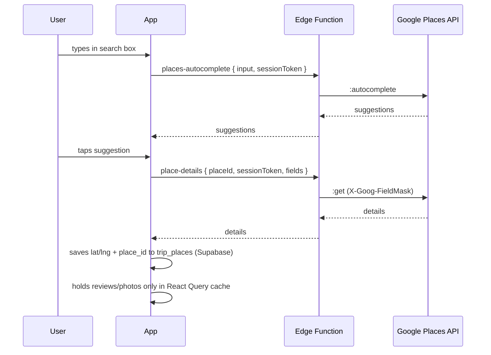
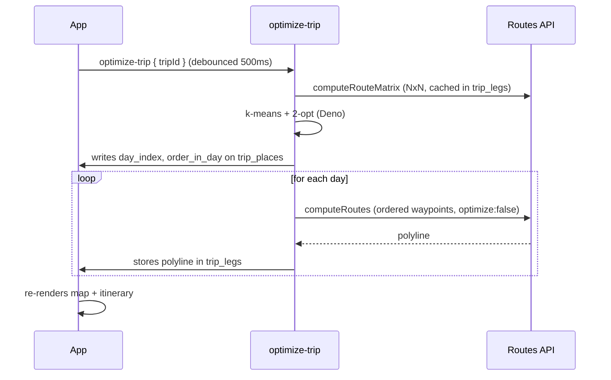

# Architecture

## Platforms & deploy

- **Native (iOS + Android)**: Expo SDK 52+ + React Native 0.76 via **EAS Build** + **EAS Update** (OTA). Requires `expo-dev-client` — **Expo Go not supported** due to `react-native-maps`.
- **Web**: `expo export --platform web` → static bundle → **Cloudflare Pages** or Vercel.
- **One codebase**: `app/` (Expo Router) + `src/` (shared). Platform-specific files use `.native.tsx` / `.web.tsx`.

## Backend

- Supabase project: Postgres + Auth + Edge Functions.
- Tables: `trips`, `trip_days`, `trip_places`, `trip_legs`, `trip_expenses`. See `supabase/migrations/0001_init.sql` and `supabase/migrations/0010_trip_budget_categories.sql`.
- **RLS on every table**; child tables scoped via `trips.user_id`.

## Data model additions (Phase 20)

### `trips.total_budget`

New nullable column `total_budget numeric` added in migration `0010_trip_budget_categories.sql`. Represents the user's overall financial budget for the trip (not per-km). No unit enforcement — currency is inherited from `trips.currency`. The existing `cost_per_km` column is retained for backwards compatibility but deprecated via `COMMENT ON COLUMN`.

### `trip_expenses` table

Tracks categorized estimated and actual expenses for a trip.

| Column | Type | Notes |
|---|---|---|
| `id` | `uuid pk` | default `gen_random_uuid()` |
| `trip_id` | `uuid fk trips` | cascade on delete |
| `category` | `text` | CHECK IN (`accommodation`, `food`, `transport`, `shopping`, `activities`, `other`) |
| `kind` | `text` | CHECK IN (`estimated`, `actual`) |
| `amount` | `numeric` | CHECK `amount >= 0` |
| `label` | `text null` | optional user description |
| `day_index` | `int null` | links to a specific trip day; null means trip-level |
| `created_at` | `timestamptz` | default `now()` |

**RLS**: four policies (select / insert / update / delete) all scoped via `trip_id IN (SELECT id FROM trips WHERE user_id = auth.uid())`.

**Client API** (`src/api/trip-expenses.ts`): Zod schema + types; `useTripExpenses(tripId)`, `useCreateTripExpense()`, `useUpdateTripExpense()`, `useDeleteTripExpense()`. Query keys live in the shared `src/api/_keys.ts` leaf module.

**UI**: deferred to Phase 21 — the data layer is live but no expense entry UI exists yet.

### RLS special case — `trip_shares`

`trip_shares` deliberately has **no SELECT policy**. Share tokens must never be readable by any client JWT after creation; the only read path is the admin-client Edge Function (`share-trip/index.ts`). This design has two non-obvious consequences that must be preserved:

- **`INSERT ... RETURNING` under a user JWT fails with `42501`** even though the row is written. Postgres evaluates the `RETURNING` clause against SELECT policies; since none exist, it cannot read the row back. The correct pattern is `.insert(data)` without `.select()`. The `create` operation in the Edge Function uses the admin client to avoid this.
- **`UPDATE` under a user JWT silently no-ops** (row count 0, no error). The row is invisible to the caller's SELECT policy, so Postgres treats it as non-existent for the update. All production writes to `trip_shares` — create, revoke — must go through the admin client. Ownership must be proven separately via a user-JWT SELECT on `trips` before the admin client acts.

These constraints are documented via `COMMENT ON POLICY` in `supabase/migrations/0009_share_insert_policy_note.sql`.

## Edge Function error envelopes

All Edge Functions return errors in the shape `{ error: { code: string, message: string } }` with an appropriate HTTP status.

### `EdgeFunctionError` hierarchy (Phase 20)

`src/api/_errors.ts` defines a shared base class:

```ts
class EdgeFunctionError extends Error {
  constructor(public code: string, public message: string, public status: number) { ... }
}
```

Concrete subclasses:

- **`OptimizeError`** (`src/api/routes.ts`) — extends `EdgeFunctionError`; known codes: `already_optimizing`, `too_many_places`, `matrix_failed`, `not_found`, `rpc_failed`, `db_error`, `invalid_input`, `method_not_allowed`.
- **`PlacesError`** (`src/api/places.ts`) — extends `EdgeFunctionError`; includes the special code `server_misconfigured` returned when `GOOGLE_MAPS_SERVER_KEY` is absent from Edge Function secrets.

### `server_misconfigured` envelope

When `GOOGLE_MAPS_SERVER_KEY` is not set, the Edge Functions `places-autocomplete`, `place-details`, `distance-matrix`, and `directions-polyline` all return:

```json
{ "error": { "code": "server_misconfigured", "message": "Google Maps server key is not configured. See docs/google-maps-setup.md." } }
```

The client (`src/api/places.ts`) parses this into a `PlacesError` instance. `app/(app)/trip/[id]/add.tsx` renders a setup banner when this code is detected.

## Web layout breakpoints (Phase 20)

`src/hooks/useBreakpoint.ts` returns the current breakpoint based on window width:

| Name | Threshold | Screens using it |
|---|---|---|
| `mobile` | < 768 px | default (single-column) |
| `tablet` | 768–1023 px | tablet-optimised spacing |
| `desktop` | ≥ 1024 px | two-column auth; 2-col trips grid; trip detail 60/40 split |
| `desktopWide` | ≥ 1440 px | trips list 3-col grid |

Screens with desktop-specific layouts:
- `app/(auth)/login.tsx` + `app/(auth)/signup.tsx` — two-column (imagery left, form right) at ≥1024 px.
- `app/(app)/trips.tsx` — 2-col grid at ≥1024 px; 3-col at ≥1440 px.
- `app/(app)/trip/[id]/index.tsx` — side-by-side map + itinerary (~60/40) at ≥1024 px; collapses to two tabs on mobile.
- `app/(app)/trip/[id]/add.tsx` — 720 px max-width centered on desktop.

## Third-party APIs

- **Google Maps Platform** — Places API (New), Routes API, Maps SDK (native), Maps JS (web).
- **Client-side key** (bundled): Maps SDK only. Restricted by bundle id + SHA1 (native) or HTTP referer (web).
- **Server-side key** (Supabase secret): everything else — Places HTTP, Routes HTTP. Never ships to client.

For the full two-key setup guide (Cloud Console steps, where each key lives, verification curl commands, and free-tier guidance) see `docs/google-maps-setup.md`. The project deliberately separates the server key (API-restricted to Places + Routes, no referrer restriction) from the web JS key (restricted to Maps JavaScript API + HTTP referrer) so each leaked key has bounded blast radius.

## Auth

- Supabase magic-link email auth.
- Session stored via `expo-secure-store` (native) / `localStorage` (web), both wired into `@supabase/supabase-js`.

## Data flow — adding a place



## Data flow — optimize route



## Caching (Google ToS)

- **Persistable forever**: `google_place_id`, `lat`, `lng`, user-authored fields.
- **Not persisted server-side**: rating, reviews, photos, opening hours, phone, website, attributions.
- **Client cache only** (TanStack Query): `staleTime: 1h`, `gcTime: 24h`, persisted via AsyncStorage for offline view.
- **`trip_legs`**: 30-day TTL; re-fetch if `computed_at` older.

## Attribution (required)

- Place detail screens: "Powered by Google" footer whenever Place fields render.
- Each review: author name + relative time + profile photo per Google spec.
- Photos: render `attributions[]` beneath.
- Map: Google logo not obscured (native + web).

## Optimizer contract

`src/lib/optimizer/kmeans-2opt.ts` exports:

```ts
type Place = { id: string; lat: number; lng: number; visitMinutes: number };
type Leg = { fromId: string; toId: string; durationSeconds: number };
type Day = { dayIndex: number; orderedPlaceIds: string[]; totalMinutes: number };

function optimize(params: {
  places: Place[];
  legs: Leg[];                      // NxN travel matrix
  dailyBudgetMinutes: number;
  anchorPlaceId?: string;
  dayStartEnd?: Record<number, { startId?: string; endId?: string }>;
}): Day[]
```

Shared by the `optimize-trip` Edge Function. Keep it pure — no I/O.

## Environment variables

### Client (bundled, safe to expose)

```
EXPO_PUBLIC_SUPABASE_URL=https://<project>.supabase.co
EXPO_PUBLIC_SUPABASE_ANON_KEY=<anon>
EXPO_PUBLIC_GOOGLE_MAPS_WEB_KEY=<referer-restricted-web-key>
```

### Server (Supabase Edge Function secrets, never bundled)

```
GOOGLE_MAPS_SERVER_KEY=<unrestricted-server-key>
ALLOWED_ORIGINS=https://tripvisor.pages.dev,https://tripvisor.app,http://localhost:8081
```

`ALLOWED_ORIGINS` fails closed. If unset, Edge Functions accept no cross-origin browser traffic — set it explicitly for every environment.

### Google Places photos — referer restriction REQUIRED

Photo URLs are built client-side on the place-details screen using
`EXPO_PUBLIC_GOOGLE_MAPS_WEB_KEY` as the query param. That key **must** be
referer-restricted in Google Cloud Console (HTTPS allow-list for the
deployed web host, plus `localhost` for dev). Without the restriction the
key can be extracted from network traffic and reused to burn quota.

Native Maps SDK keys live in `app.json` under `ios.config.googleMapsApiKey` and `android.config.googleMaps.apiKey` — those are embedded in the binary and restricted by bundle id.
