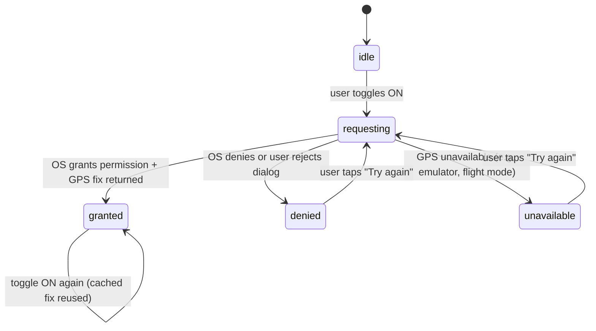

# Location-aware routing

**Status**: 🚧 In progress
**Owner agents**: ui-specialist, backend-specialist
**Depends on**: Route optimization (Phase 2 — `directions-polyline` Edge Function, MapTab structure), Trip collaboration (Phase 21 — `useTripRole` for read-only gating)

## Platforms verified
- ☐ iOS
- ☐ Android
- ☐ Web
(Smoke and automated tests deferred per user direction on 2026-04-26.)

## User story
As a traveler, I want to toggle "Start route from my current location" on the MapTab so that I can see how far my GPS position is from the first stop of a day and plan my departure accordingly — without affecting the saved itinerary.

## UI

### Screen
`app/(app)/trip/[id]/index.tsx` — MapTab surface. A "From my location" toggle row appears near the existing "Best route / My order" segmented control.

### Key interactions
- **Toggle ON (idle)**: triggers `useCurrentLocation().request()`. If permission is already granted, uses the cached fix. If not yet requested, the OS permission dialog appears.
- **Toggle ON (granted)**: prepends a synthetic polyline from `(userLat, userLng)` to the first place of the active day (or the first day when filter is "All days"). Same day-color as live legs.
- **Toggle ON (denied / unavailable)**: inline error copy — "Location permission needed — enable in browser/system settings" — is shown below the toggle. Toggle reverts to OFF.
- **Toggle ON (re-tap within session)**: cached GPS fix is reused without re-requesting permission (60-second module-level cache).
- **Toggle OFF**: virtual leg is removed from the map. DB and AsyncStorage toggle state are updated.

### Platform differences
- **Web**: `navigator.geolocation.getCurrentPosition` with a 10 s timeout. Works on `localhost` and HTTPS origins; blocked on plain HTTP (documented in known limitations).
- **Native (iOS / Android)**: `expo-location` — `requestForegroundPermissionsAsync()` then `getCurrentPositionAsync({ accuracy: Balanced })`. The Expo permission dialog uses the `NSLocationWhenInUseUsageDescription` string in `app.json` / the Android manifest permissions.

## Data

### Tables touched
None — the virtual leg is render-only and never written to `trip_legs` or any other table.

### New columns/tables
None.

### AsyncStorage key
`tripvisor:useMyLocation:<tripId>` — boolean. Set by `useTripUseMyLocation(tripId)`. Default `false`. Survives navigation within the session. Not synced cross-device.

### Orphan keys
If a trip is deleted, its AsyncStorage toggle key is never cleaned up. This is harmless (the key is small; the next time the trip ID is used — which is never after deletion — a fresh default of `false` would be read). Documented in `src/hooks/useTripUseMyLocation.ts`.

### RLS
Not applicable — no DB writes occur.

## APIs

### Edge Functions called
`directions-polyline` — called with raw lat/lng coordinates for `origin` and `destination`. The function was confirmed in Phase 24 to accept `{ origin: {lat, lng}, destination: {lat, lng}, intermediates?: [{lat, lng}], mode }` without requiring Place IDs. No contract change was needed.

The call is made from client → Supabase Edge Function → Google Routes API. The user's lat/lng leaves the device to this Edge Function (proxied; never sent to Google directly from the client).

### Google API endpoints
Routes API (`computeRoutes`) — called by `directions-polyline` Edge Function. Same billing/quota as regular route computation.

## Permission flow state machine

## Edge cases

- **Permission denied on first prompt**: toggle reverts to OFF; inline error shown. User must grant permission in system settings; tapping "Try again" re-requests (some platforms allow re-requesting).
- **GPS unavailable** (e.g., iOS Simulator without location override, airplane mode): `unavailable` state; same inline error.
- **Active day has no places**: toggle has no effect (no first place to route to). The virtual leg is silently skipped.
- **`directions-polyline` returns null polyline** (transit mode): a geodesic straight-line fallback is rendered as a dashed line — same behavior as the transit dashed-line fallback for live legs.
- **Toggle ON during animation / map loading**: the Edge Function call is debounced by component state; the polyline renders when the response arrives (no spinner for v1).
- **Collaborator with viewer role**: the toggle is visible and functional — reactions and location do not require edit access. The toggle only reads the user's own GPS; it does not write to any trip data.
- **Web on HTTP origin**: `navigator.geolocation` is blocked by browsers on non-secure origins (except `localhost`). The hook returns `unavailable`; the inline error message reads "Location unavailable in your browser."

## Test plan
Deferred per user direction on 2026-04-26 (same policy as Phases 21–23).

When executed:
- **Unit**: `useCurrentLocation` hook — mock `navigator.geolocation.getCurrentPosition` (web) and `expo-location` (native); assert state transitions for granted / denied / unavailable. Assert no lat/lng is written to AsyncStorage or any Supabase table.
- **Unit**: `useTripUseMyLocation` — assert AsyncStorage read/write under key `tripvisor:useMyLocation:<tripId>`; assert default `false`.
- **Component (native + web)**: MapTab toggle renders in all three permission states; error copy appears on denied/unavailable; virtual polyline prop is passed to Map component when granted.
- **Integration**: `directions-polyline` Edge Function accepts raw `{lat, lng}` input without Place IDs.
- **E2E (web Playwright)**: grant geolocation via Playwright `context.setGeolocation` + `context.grantPermissions(['geolocation'])`; toggle ON; assert a polyline is added to the map. Separately test denial path.
- **Manual native smoke (iOS + Android)**: toggle ON with device location enabled; verify polyline renders from current GPS position to day's first place; toggle OFF removes it.

## Known limitations
- Virtual leg is only computed for the first place of the active day. A finer-grained "start from my location to any day" override is deferred to Phase 25+.
- No continuous tracking — the hook fetches a single fix when the toggle turns ON. Background location updates are explicitly out of scope (privacy / battery cost).
- Web requires HTTPS or `localhost`. Plain HTTP deployments cannot use geolocation.
- iOS Simulator and some Android emulators return null or stale fixes; manual native smoke requires a real device or a simulator with an overridden location.
- The user's lat/lng is sent to the `directions-polyline` Edge Function and from there to the Google Routes API. This is the minimum necessary for routing and is documented here as the privacy disclosure.
