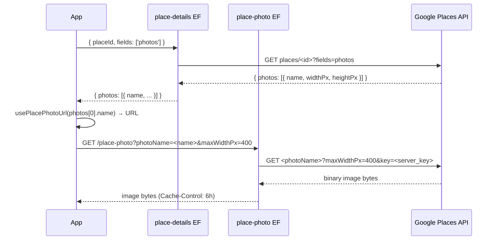

# photos

**Status**: 🚧 In progress — `place-photo` Edge Function + `usePlacePhotoUrl` + cover photo UI + place thumbnails shipped Phase 25 (2026-04-26)
**Owner agents**: backend-specialist (Edge Function, API), ui-specialist (TripCard, ItineraryTab, CoverPickerModal)
**Depends on**: place-search, trip-crud

## Platforms verified
- ☐ iOS
- ☐ Android
- ☐ Web

## User story
As a traveler, I want to see a photo of each place in my trip itinerary and a cover photo on each trip card, so that my trips feel visually rich and I can quickly recognize them at a glance.

## UI

### Trip cover photo (TripCard + SettingsTab)
- **`src/components/TripCard.tsx`** — when `trip.cover_photo_google_place_id` is set, renders a `CoverHero` block (~120 px tall) using `usePlaceDetails(['photos'])` to fetch `photos[].name`, then `usePlacePhotoUrl(photoName, { maxWidthPx: 400 })` to construct the proxy URL. Falls back to a gradient placeholder when cover is unset or the photo fetch fails. Shows a skeleton while loading.
- **Settings tab** (`app/(app)/trip/[id]/index.tsx`) — `CoverPhotoSection` shows the current cover preview plus "Set cover" / "Change" / "Remove" buttons. Role-gated: visible only when `canEdit` is true.
- **`CoverPickerModal`** — lists all `trip_places` with 44x44 thumbnails; tapping one selects it as cover and calls `useUpdateTrip({ cover_photo_google_place_id: placeId })`.

### Place thumbnails (ItineraryTab)
- **`PlaceRow`** in `app/(app)/trip/[id]/index.tsx` — each place renders a 44x44 `PlaceThumbnail` using the same `usePlaceDetails` + `usePlacePhotoUrl` pipeline. Skipped gracefully when Google returns no photos for a place.

### Notes editor (Phase 25 co-shipped)
- **`PlaceNotesEditor`** in the same `PlaceRow` — gate on `canEdit`
- **`AccommodationNotesEditor`** in `AccommodationCard.tsx` — inline tap-to-edit; read-only for viewers

- Platform differences: none — `<Image>` from `expo-image` is cross-platform; the URL pipeline is identical on all three platforms

## Data
- New column: `trips.cover_photo_google_place_id text null` (migration `0018_trips_cover_photo.sql`)
- Cover column is in the editor allow-list of `enforce_trips_column_restrictions` trigger — editor collaborators can change the cover without owner permission
- Photo metadata (`photos[].name`, `photos[].widthPx`, `photos[].heightPx`) is held in the TanStack Query cache only — never written to the database (Google Places ToS: no server-side persistence beyond 30 days)

## APIs

### `place-photo` Edge Function (`supabase/functions/place-photo/index.ts`)
- Endpoint: `GET /functions/v1/place-photo?photoName=places/<id>/photos/<ref>&maxWidthPx=<n>`
- Default `maxWidthPx`: 400. Clamped to 1–4800.
- `verify_jwt = false` (set in `supabase/config.toml [functions.place-photo]`) because `<Image src>` cannot send Authorization headers. Photo names are tied to public Google Place IDs; the server key never leaves the function.
- Streams the binary image bytes back with `Cache-Control: public, max-age=21600` (6 h, matches Google photo URL expiry).
- Validates `photoName` against regex `^places/[A-Za-z0-9_\-]+/photos/[A-Za-z0-9_\-]+$` to prevent generic CDN proxying.
- Error codes: `invalid_input` (400), `server_misconfigured` (500), `photo_not_found` (404), `google_places_disabled | google_key_restricted | google_places_forbidden | upstream_error` (502), `upstream_timeout` (504).
- Has its own README at `supabase/functions/place-photo/README.md`.

### `_shared/cors.ts`
- `Access-Control-Allow-Methods` widened to `GET, POST, OPTIONS` in Phase 25 to support the new GET-based `place-photo` function.

### `usePlacePhotoUrl` (`src/api/place-photos.ts`)
- Pure URL builder — no network call, no TanStack Query.
- Signature: `usePlacePhotoUrl(photoName: string | null | undefined, options?: { maxWidthPx?: number }): { url: string | null }`
- Constructs `${SUPABASE_URL}/functions/v1/place-photo?photoName=<enc>&maxWidthPx=<n>&apikey=<anon>`.
- Returns `{ url: null }` when `photoName` is falsy.
- Re-exported from `src/api/index.ts`.

### `place-details` Edge Function
- Already accepts `'photos'` in fields array; response includes `photos[].name` resource names. No contract change in Phase 25.

## Pipeline: place-details to displayed image

## Why server-side proxying
- Google's per-photo fetch URL requires the server API key, which must never be bundled in the client (CLAUDE.md constraint)
- Browser `<Image>` cannot send Authorization headers, making JWT-gated functions unusable for ``; the `verify_jwt = false` exception is acceptable because photo names are tied to public Place IDs and carry no user data
- Server-side streaming allows a 6-hour Cache-Control header, reducing API quota consumption

## ToS compliance
- `photos[].name` photo resource names: held in React Query cache only. Not written to DB. Cache TTL: `staleTime: 1h`, `gcTime: 24h`. Not dehydrated to AsyncStorage (not in the offline allowlist).
- `cover_photo_google_place_id` on `trips`: this is a `google_place_id` string — permanently storable per ToS. The photo bytes themselves are never stored server-side.
- Attribution: "Powered by Google" footer required on any screen that displays Place-sourced data. `TripCard` and `PlaceThumbnail` do not individually show attribution, but `place details` screens carry it. See `docs/architecture.md` Attribution section.

## Edge cases
- Place returns no photos: `usePlacePhotoUrl` returns `{ url: null }`; UI falls back to gradient placeholder / no thumbnail
- `place-photo` function not deployed: `<Image>` shows a broken-image state; no crash
- `cover_photo_google_place_id` references a place that has since been removed from the trip: the photo still loads from Google (the Place ID is still valid on Google's side); the "Remove" button in the cover picker clears it

## Test plan
- Unit: `usePlacePhotoUrl` — null input, valid input, maxWidthPx clamping. Deferred — Phase 25 tests skipped per user direction.
- Edge Function: `place-photo` — invalid regex, missing server key, upstream 404, cache-control header. Deferred.
- Component: `TripCard` renders gradient fallback when `cover_photo_google_place_id` is null. Test fixture updated in Phase 25 (one-line `cover_photo_google_place_id: null` addition).
- E2E (web Playwright): pick a cover photo and verify TripCard renders the image. Deferred.
- Manual native smoke (iOS + Android): deferred to user smoke.
