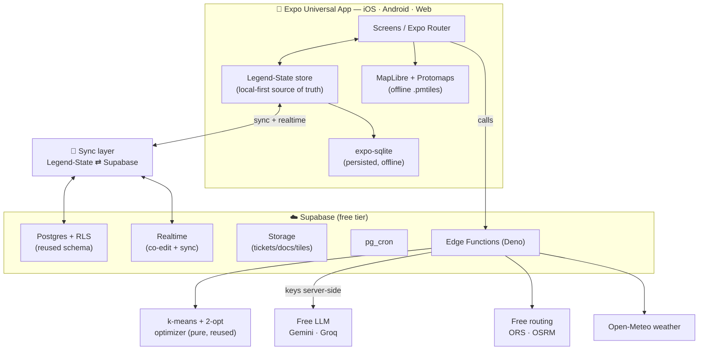
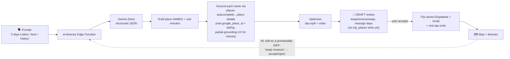

# Tripvisor v2 — Architecture

> **Status:** Draft v2 blueprint (2026-06-09). Greenfield redesign that **reuses the proven core**.
> Being enriched by a multi-agent design pass; treat as the working target, not frozen.

## North star

Tripvisor is an Expo **universal** (iOS · Android · Web, one codebase) holiday **route planner**:
add real places → it clusters them into days and orders visits to minimise travel time within a
daily **time** budget (k-means + 2-opt) → renders the route on a map.

v2 keeps that essence and adds three things the product was missing: an **AI planning brain**, a
genuine **offline-first** experience, and **depth** (weather, packing, documents, native parity).

## Hard constraints (v2)

1. **Free only.** Every API/service/tool is free / open-source / free-tier with a realistic **$0 ceiling** at hobby scale.
2. **Greenfield, but reuse the gold.** Redesign navigation/state/screens/data-model gaps — but keep the proven optimizer, RLS model, Edge Functions, and Supabase schema core.
3. **Time-first.** Duration/visit-time is the primary unit. The legacy `cost_per_km` model is **retired**.
4. **Google ToS.** Never persist Google reviews/photos/ratings/hours server-side — only `google_place_id` + lat/lng are durable; keys never ship to the client.

## Reuse-vs-Rebuild ledger

| Reuse (the gold) | Rebuild / redesign |
|---|---|
| `src/lib/optimizer` — pure k-means + 2-opt | State layer: TanStack Query → **local-first** (Legend-State) |
| RLS model + `user_can_access_trip()` helper | Offline coverage: 3 entity roots → **all entities** (map tiles deferred — native-first, post-GA) |
| Edge Function proxies (places, routes, optimize-trip) | Navigation/IA: split the **2442-line** `trip/[id]/index.tsx` god-screen |
| Supabase schema core (`trips` + child tables) | Cost model: remove `cost_per_km` → category `trip_expenses` + time metrics |
| Design tokens (`src/theme`) | Charts: hand-rolled SVG → Skia/victory-native (React 19) |
| Magic-link auth | New AI surfaces + offline sync engine |

## Layered architecture

| Layer | Choice (all free) | Notes |
|---|---|---|
| App framework | **Expo SDK 54 + React 19.1 + New Arch** (two-step 52→53→54), Expo Router | React 19 unblocks **react-native-gifted-charts** (web+native) |
| Local-first state | **Legend-State v3** store = source of truth (Tier-1) | persisted to **expo-sqlite**; TanStack Query kept for ToS-restricted Google/optimizer reads (Tier-2) |
| Sync | Legend-State **`syncedSupabase`** ⇄ Supabase **Realtime** | write-queue; **per-field LWW** via server-stamped `updated_at` + soft-delete `deleted`; **order columns are server-authoritative** (not LWW) |
| Backend | **Supabase free** (Postgres + RLS reused) | newly adopt **Realtime · Storage · pg_cron** |
| Edge Functions (Deno) | reused proxies + new **ai-plan · ai-edit · weather** | all third-party keys stay server-side |
| Maps + routing | **Web:** MapLibre + OpenFreeMap (no key) · **Native:** keep react-native-maps+Google ($0 render; MapLibre deferred) · **Routing:** self-host OSRM / ORS behind existing Edge Fns | Google env-flag fallback; see [risks C2](risks-and-decisions.md) |
| AI / LLM | **Gemini 2.5-flash/-flash-lite** (primary) + **Groq gpt-oss-20b** (fallback) | `responseSchema` structured output; **grounding loop** (place names → places-autocomplete→place-details); proxied via Edge Fn |
| Weather | **Open-Meteo** | free, **no key**, commercial-friendly |
| Supporting | Sentry free · PostHog free · Expo Push · GitHub Actions + EAS free + Cloudflare Pages + Expo OTA | |

## System architecture (graph)



### ASCII (terminal-friendly)

```
┌──────────────────────────────────────────────────────────────┐
│        EXPO UNIVERSAL APP   (iOS · Android · Web)            │
│   Screens ⇄ Legend-State store ──► expo-sqlite (offline)    │
│      │            (local-first source of truth)             │
│      └──► MapLibre + Protomaps tiles (offline .pmtiles)     │
└───────────────┬──────────────────────────────────────────────┘
                │  sync + realtime (write-queue, LWW per field)
        ┌───────▼─────────────────────────────────────┐
        │            SUPABASE  (free tier)             │
        │  Postgres+RLS  Realtime  Storage  pg_cron    │
        │              Edge Functions (Deno)           │
        └───────┬───────────┬───────────┬──────────────┘
                │           │           │   (all keys server-side)
         ┌──────▼───┐ ┌─────▼────┐ ┌────▼─────┐ ┌──────────────┐
         │ Optimizer│ │ Free LLM │ │  Free    │ │  Open-Meteo  │
         │ kmeans/  │ │ Gemini/  │ │ routing  │ │   weather    │
         │ 2-opt    │ │ Groq     │ │ ORS/OSRM │ │  (no key)    │
         │ (reused) │ └──────────┘ └──────────┘ └──────────────┘
         └──────────┘
```

## AI pipeline



Principle: **the LLM proposes, Google Places grounds, the optimizer disposes — and the user decides.**
The LLM returns structured place **names** + estimated visit minutes; the server **grounds** each name
through the existing `places-autocomplete → place-details` chain to obtain a real `google_place_id` +
lat/lng (**LLM coordinates are never trusted or persisted**); the pure optimizer day-splits and orders;
the result lands as a **DRAFT** (staged, not written to `trip_places`) that the user reviews —
keep/remove/swap, reassign days — and commits on accept, with one-tap undo after apply. NL edits are
**previewable diffs**, never auto-applied. Google place data stays **cache-only** per ToS.

**AI run lifecycle (failure paths are the normal case at free-tier limits):**
- **Partial grounding** — grounding is location-biased to the destination; unresolvable names return a
  partial draft with "couldn't find these N places" for user fix-up, never silent drops.
- **Idempotency** — each run gets an idempotency key stored in `trip_ai_runs`; client retries/timeouts
  reuse the stored LLM draft instead of double-billing Gemini RPD + Google grounding credit.
- **Quota** — the C4 per-user quota table doubles as the **usage ledger from day one** (AI runs,
  grounding calls, routing calls); the quota-exhausted state has defined UX. Grounding calls are
  **Google-metered** (see [risks](risks-and-decisions.md)) — a 3-day trip ≈ 20–30 metered calls.

## Sync & conflict model

- **Source of truth is local.** The Legend-State store (persisted to SQLite/MMKV) is what the UI reads/writes. Edits are optimistic and work fully offline.
- **Sync plugin** mirrors local ⇄ Supabase using Supabase Realtime for push and a write-queue for offline mutations.
- **Two-tier split:** Legend-State owns durable user tables (Tier-1); TanStack Query keeps ToS-restricted Google/optimizer reads memory-only (Tier-2). Tier-1 has its **own write-allowlist + lint guard** so Google-restricted fields can't leak into SQLite — see [ToS condition C3](risks-and-decisions.md).
- **Conflict policy:** **per-field last-write-wins** on server-stamped `updated_at` + soft-delete `deleted` boolean (via a `handle_times()` trigger). **NOT CRDT** — records are structured and route order is a recompute.
- **Order authority (C1, refined 2026-06-10):** order is **two fields, two owners**. *User-intent order* = **`manual_rank`** (fractional index on `trip_places`) — client-writable, LWW-synced, works offline; v1's manual mode (`apply_manual_day_order` RPC, `route_render_mode='manual'`) already establishes user-owned ordering, so C1-as-originally-written would have outlawed a shipped feature. *Optimizer-computed order* = `day_index` / `order_in_day` / `trip_legs` — **server-computed only** (the `optimize-trip` mutex path, incl. its manual branch recomputing legs from `manual_rank`), never client-LWW-merged. `route_render_mode` picks which renders. **Offline drag** writes `manual_rank`, shows "pending route recompute", and is **never reverted** on reconnect.
- **Map tiles** (web) for a trip's region are downloadable for offline MapLibre rendering. Google ToS forbids caching Google tiles — offline maps require the MapLibre path, else the map is honestly scoped online-only.
- **Sync status** is surfaced per entity: *synced / pending / conflict*.

## Data model additions (on top of the reused schema)

- **`trip_place_comments`** (id, trip_id, place_id, author_id, body, created_at, deleted; RLS via `user_can_access_trip`) — the core loop's "comments" leg. Append-only per-author rows → conflict-free under LWW by construction; Tier-1-safe (pure user content). *(Panel addition — v1's single shared `notes` field would let collaborators silently overwrite each other under LWW.)*
- **`trip_days.start_time`** (default 09:00) — feeds the itinerary timeline's computed per-stop arrival/departure (pure client math over `trip_legs`). *(Panel addition — "time-first" finally shows times.)*
- **`trip_places.manual_rank`** (fractional index) — user-intent order; see the C1 refinement above.
- **`app_config`** (key/value, read at startup, cached) — runtime kill-switches for the risky cutovers: web map provider, routing provider, sync-engine-per-entity. `EXPO_PUBLIC_*` vars become defaults only — build-time flags can't steer shipped native clients without burning an EAS build.
- `trip_documents` (Supabase Storage refs: tickets, reservations, passport scans; RLS via `user_can_access_trip`; injection-safe path-prefix → `user_can_access_trip` guard for `storage.objects`).
- `trip_packing_items` (auto-seeded + user-edited; offline).
- `trip_ai_runs` (audit of AI runs — prompt hash, model, tokens, **idempotency key**; no PII) + the C4 **quota/usage-ledger** table (per-user AI + grounding + routing counters, live from N3).
- `trip_places.arrive_after` / `leave_before` (user-confirmed time-windows — never auto-filled from Google hours).
- ~~`trip_meals` table~~ → reduced to a `meal_slot` tag on `trip_places`, post-GA (panel cut: schema overreach).
- Drop `trips.cost_per_km` (P5, grep-gated); keep category `trip_expenses`.
- All new child tables follow the RLS pattern: SELECT via `user_can_access_trip(...,'viewer')`, write via `...'editor'` (comments: author-only write).

## Security & Google ToS posture

- Server keys (LLM, routing, Google) live only in Edge Function secrets; never bundled.
- Google place content (reviews/photos/ratings/hours) is **never** persisted — client cache only.
- Attribution ("Powered by Google" / per-review) preserved wherever Google data renders. If MapLibre+Protomaps fully replaces Google rendering on a screen, OSM/Protomaps attribution is shown instead.
- RLS on every trip-scoped table via the reused helper.
- AI prompts/outputs logged without PII; document storage RLS-scoped and access-controlled.

## Deployment (all free)

- **Web:** `expo export --platform web` → **Cloudflare Pages** (free).
- **Native:** **EAS free tier** builds (watch the monthly build-minute budget) + **Expo OTA** updates.
- **Backend:** Supabase free project (mind the 1-week inactivity pause + 500MB DB / 1GB storage limits).
- **CI:** GitHub Actions (free) — unit + component + Edge Function + web E2E.

## Open decisions (need user input)

- Maps: go **fully free** (MapLibre + Protomaps + ORS/OSRM, true $0 + offline tiles) vs **keep Google** under its free credit (richer places, but a credit-card-backed account). v2 default: MapLibre, Google optional.
- Offline engine: **Legend-State + Supabase plugin** (recommended) vs **expo-sqlite + custom sync**.
- LLM: confirm **Gemini free tier** is acceptable (Google account) vs **Groq-only**.

See also: [`features.md`](features.md) · [`tech-stack.md`](tech-stack.md) · [`migration.md`](migration.md) · [`../../plan-v2.md`](../../plan-v2.md)
