# Tripvisor v2 — Feature Catalog

> **Status:** Draft v2 (2026-06-09). Focus areas (user-chosen): **AI-assisted planning · offline-first · depth/polish**, plus optimizations of existing features. All dependencies **free**.
> Per-feature data-model/backend/effort detail is being enriched by the multi-agent design pass.

Legend: **P0** = foundational/must-have · **P1** = high value · **P2** = nice-to-have.

## Feature map

```mermaid
graph TD
  V2["Tripvisor v2"] --> AI["🤖 AI planning"]
  V2 --> OFF["📴 Offline-first"]
  V2 --> DEP["✨ Depth & polish"]
  V2 --> OPTz["🔧 Optimize existing"]

  AI --> AI1["Plan my trip"] & AI2["NL editing"] & AI3["Smart suggestions"] & AI4["Auto budget+packing"] & AI5["Why this order?"]
  OFF --> O1["Full offline itinerary"] & O2["Offline edit + queue"] & O3["Offline map tiles"] & O4["Sync status UI"]
  DEP --> D1["Weather + rainy-day swaps"] & D2["Packing lists"] & D3["Doc/ticket storage"] & D4["Meal planning"] & D5["Native parity"]
  OPTz --> X1["Retire cost_per_km"] & X2["Fix analytics cap"] & X3["Split god-screen"] & X4["Realtime co-edit"] & X5["Optimizer upgrades"]
```

---

## A · AI-assisted planning

Free LLM: **Gemini 2.5-flash / -flash-lite** (primary) + **Groq `gpt-oss-20b`** (fallback), `responseSchema` structured output, proxied via the `ai-itinerary` / `ai-edit` Edge Functions (keys server-side). The LLM proposes place **names**; the server **grounds** them via the existing `places-autocomplete → place-details` chain (real `google_place_id` + lat/lng — LLM coords never trusted); then the **existing optimizer disposes** (day-split + ordering). A **per-user quota** guards the shared keys (see [risks C4](risks-and-decisions.md)).

| # | Feature | Pri | User story | Backend / data |
|---|---|---|---|---|
| A1 | **Plan my trip** | P0 | *"3 days in Lisbon, food + history, mid budget, walking"* → AI drafts day-by-day places → grounded via Google Places → optimizer time-orders them. | `ai-itinerary` Edge Fn → LLM `responseSchema` → ground names → `optimize-trip`; writes `trip_places`; logs `trip_ai_runs` (no PII). |
| A2 | **Natural-language editing** | P1 | *"swap the museum for something outdoors near lunch"* → structured diff applied. | `ai-edit` Edge Fn returns a patch; applied optimistically + re-optimize. |
| A3 | **Smart gap-fill suggestions** | P1 | When a day has slack time, suggest ToS-safe nearby places. | LLM + free routing for "near"; Google data cache-only. |
| A4 | **Auto budget + packing list** | P1 | Category budget estimate (time-first) + packing list from destination/season/weather. | LLM seed → `trip_expenses` (estimated) + `trip_packing_items`. |
| A5 | **"Why this order?"** | P2 | AI narrates the optimizer's day-split rationale. | read-only LLM call over optimizer output. |

**ToS:** AI never persists Google reviews/photos/ratings; suggestion cards stay Tier-2 (memory-only) until accepted. Only user text + place names go to the LLM (free-tier Gemini may train on prompts). Note the **grounding calls are Google-metered** against the $200 credit — see [risks](risks-and-decisions.md).

---

## B · Offline-first

Engine: **Legend-State** local store (SQLite/MMKV) ⇄ **Supabase Realtime** sync. Map tiles via **MapLibre + Protomaps**.

| # | Feature | Pri | User story | Backend / data |
|---|---|---|---|---|
| B1 | **Full offline itinerary** | P0 | Every entity readable offline (places, days, legs, expenses, accommodations, notes, reactions) — today only 3 are cached. | local store hydrates all trip child tables. |
| B2 | **Offline editing + write-queue** | P0 | Edit anywhere; optimistic UI; syncs on reconnect. | write-queue; LWW per field via `updated_at`; CRDT ordering for drag. |
| B3 | **Offline map tiles** | P1 | Download the trip region for offline maps (web MapLibre). | `.pmtiles`/OpenFreeMap slice in `expo-file-system` (not Storage). Native vector offline deferred to New-Arch phase; honest fallback = map online-only, itinerary fully offline. |
| B4 | **Sync status UI** | P1 | Per-entity *synced / pending / conflict* indicators + conflict resolver. | derived from sync layer state. |
| B5 | **Graceful AI/weather degradation** | P1 | When offline, AI/routing/weather features show cached or disabled states cleanly. | feature-flag on connectivity. |

---

## C · Depth & polish

All free APIs.

| # | Feature | Pri | User story | Backend / data |
|---|---|---|---|---|
| C1 | **Weather per day + rainy-day swaps** | P1 | Each day shows forecast; rainy days suggest indoor alternatives. | **Open-Meteo** (free, no key) via `weather` Edge Fn; pairs with A3. |
| C2 | **Packing lists** | P1 | Auto-seeded from destination + season + weather + activities; editable, offline. | `trip_packing_items` table. |
| C3 | **Document/ticket storage** | P1 | Store boarding passes, reservations, passport scans. | **Supabase Storage** (free 1GB); `trip_documents`; RLS-scoped. |
| C4 | **Meal planning** | P2 | Tag breakfast/lunch/dinner; slot restaurants near stops. | `trip_meals` linked to days/places. |
| C5 | **Native parity + verification** | P0 | iOS + Android actually built and smoke-verified (verified nowhere today). | EAS free builds + native smoke checklist per feature doc. |
| C6 | **Accessibility + desktop-web polish** | P1 | WCAG 2.2 AA; desktop-aware layouts, not stretched mobile. | design-system pass. |

---

## D · Optimizations of existing features

Built on the verified v1 audit.

| # | Optimization | Pri | What's wrong now → v2 fix |
|---|---|---|---|
| D1 | **Retire `cost_per_km`** | P0 | Still live in `DaySummaryCard`, `TripCostRollup`, print `/km`, trips "Cost" sort, and an editable settings input → replace with category `trip_expenses` + **time metrics**; migration drops the column. |
| D2 | **Fix analytics 10-trip cap** | P0 | `analytics.tsx` wires only `p0..p9` → scale to all trips (paginated aggregation hook). |
| D3 | **Split the god-screen** | P0 | `trip/[id]/index.tsx` is ~1000 lines → split into route segments/components (map / itinerary / settings / budget / collab). |
| D4 | **Realtime collaboration** | P1 | Today: invite + roles, no live editing → add presence + live co-edit via Supabase Realtime (reuses the same sync layer). |
| D5 | **Optimizer upgrades** | P1 | Add opening-hours / time-window awareness; real multi-leg transit (today a dashed-line fallback); per-day start/end anchor UX. |
| D6 | **Charts upgrade** | P2 | Hand-rolled SVG (blocked on React 19) → **react-native-gifted-charts** + `react-gifted-charts` (shared web+native core) after the framework upgrade. |
| D7 | **Photo/cover caching** | P2 | Reduce per-card place-details calls; batch/prefetch at list level. |
| D8 | **Test + native debt** | P0 | Phase 21–25 live-smoke debt + zero native automation → close with E2E specs + native smoke. |

---

## Navigation / IA redesign (the backbone the above plug into)

- **Home / Discover** surface where "Plan my trip" (A1) lives front-and-center — travel-product feel, destination imagery, strong hierarchy.
- **Trip detail** split from a 1000-line 3-tab god-screen into composable route segments with explicit back affordances.
- **Desktop-aware web** layouts per key screen (not a stretched mobile screen).
- Evolved design tokens/theme; onboarding; rich empty states.

See also: [`architecture.md`](architecture.md) · [`tech-stack.md`](tech-stack.md) · [`migration.md`](migration.md) · [`../../plan-v2.md`](../../plan-v2.md)
