# Tripvisor v2 — Feature Catalog

> **Status:** v2.1 (2026-06-10) — **Fable-revised** after the 5-lens review panel. Focus areas: **AI-assisted planning · offline-first · depth/polish**, plus optimizations of existing features. All dependencies **free**.
> Panel additions: **core-loop section (timeline/ETAs + place comments)**, AI **draft-review**, import-list, Ideas surface, v1 **parity checklist**. Panel cuts: web offline tiles → P2/post-GA, realtime cursors, `trip_meals` table, "Why this order?" → first-to-cut.

> **Every feature must pass the user-first UX bar** — see [`ux-principles.md`](ux-principles.md). The core loop (choose places → reviews/comments → find & adjust route on the map) must stay flexible and friendly; a rigid or confusing feature is not "Done".

Legend: **P0** = foundational/must-have · **P1** = high value · **P2** = nice-to-have.

## Feature map

```mermaid
graph TD
  V2["Tripvisor v2"] --> AI["🤖 AI planning"]
  V2 --> OFF["📴 Offline-first"]
  V2 --> DEP["✨ Depth & polish"]
  V2 --> OPTz["🔧 Optimize existing"]

  V2 --> LOOP["🔁 Core loop (NEW)"]
  LOOP --> L1["Itinerary timeline + ETAs"] & L2["Place comments"] & L3["Ideas/wishlist"] & L4["Undo everywhere"]
  AI --> AI1["Plan my trip + draft review"] & AI2["NL edits as diffs"] & AI3["Gap-fill from Ideas"] & AI4["Auto budget+packing"] & AI6["Import places list"]
  OFF --> O1["Full offline itinerary"] & O2["Offline edit + queue"] & O4["Sync status UI"]
  DEP --> D1["Weather + rainy-day swaps"] & D2["Packing lists"] & D3["Doc/ticket storage"] & D5["Native parity"] & D6n["Onboarding + OAuth"]
  OPTz --> X1["✅ Retire cost_per_km"] & X2["Fix analytics cap"] & X3["Split god-screen"] & X4["Realtime co-edit (trimmed)"] & X5["Optimizer + hours warnings"]
```

---

## L · Core loop (panel-added — the user-first heart)

| # | Feature | Pri | User story | Backend / data |
|---|---|---|---|---|
| L1 | **Itinerary timeline + computed ETAs** | P0 | Each day has an editable start time; every stop shows "arrive 10:00 → leave 12:30". | Per-day `start_time` (default 09:00); pure client math over existing `trip_legs` durations + visit minutes. Prerequisite for opening-hours warnings (X5). Lands **N1**. |
| L2 | **Per-place collaborator comments** | P0 | "Is this worth 2 hours?" — attributed, flat comment thread on each place. | `trip_place_comments` (author, body, created_at, deleted; RLS via `user_can_access_trip`; append-only → conflict-free under LWW). Schema **N2**, UI **N1**, live updates post-GA. v1's single unattributed notes field stays for personal notes. |
| L3 | **Ideas / wishlist surface** | P1 | Save places without scheduling; one-tap promote to a day. | Existing `day_index=null` bucket, named + surfaced; AI gap-fill draws from Ideas first (saves metered grounding). Lands **N1**. |
| L4 | **Undo everywhere** | P1 | Place remove, day reassign, reorder, optimize-overwrote-my-order, AI-apply — all reversible. | Inverse-ops undo stack designed into the sync mutation layer (**S2.5**); interim per-action undo on web beta where cheap. |
| L5 | **Editable timeline — pinned times** (added 2026-06-11) | P1 | Users edit the schedule directly: tap an arrival chip → set the time → the day re-flows around it. Together with editable visit durations (✓ shipped), day start times (✓), time windows (✓), and move-to-day (✓), users fully plan their days by time. | `trip_places.pinned_start time null` (migration 0025; user-authored → ToS-safe, Tier-1-syncable); `computeDayTimeline` treats pins as anchors (cursor jumps to the pin; early = wait, late/unreachable = the existing conflict-chip language); clear-pin restores computed flow. Lands **T1** (first UI wave after the redesign). |

**Parity (carried forward from v1 — protected through the rewrite):** share links · .ics export · print view · duplicate/archive · account export (JSON) · per-place/per-day notes · reactions · location-aware routing · cover photos · profile/settings · "Best route vs My order" toggle. The **N1 god-screen split is gated on this checklist** — a greenfield rewrite with no parity list is how shipped features die quietly.

---

## A · AI-assisted planning

Free LLM: **Gemini 2.5-flash / -flash-lite** (primary) + **Groq `gpt-oss-20b`** (fallback), `responseSchema` structured output, proxied via the `ai-itinerary` / `ai-edit` Edge Functions (keys server-side). The LLM proposes place **names**; the server **grounds** them via the existing `places-autocomplete → place-details` chain (real `google_place_id` + lat/lng — LLM coords never trusted); then the **existing optimizer disposes** (day-split + ordering). A **per-user quota** guards the shared keys (see [risks C4](risks-and-decisions.md)).

| # | Feature | Pri | User story | Backend / data |
|---|---|---|---|---|
| A1 | **Plan my trip → DRAFT review** | P0 | *"3 days in Lisbon, food + history, mid budget, walking"* → AI drafts → grounded → optimized → **lands as a DRAFT**: per-place keep/remove/swap + day reassign, committed only on accept, one-tap undo after apply. | `ai-itinerary` Edge Fn → LLM `responseSchema` → grounding (location-biased; **partial-grounding UX**: "couldn't find these N places", never silent drops) → optimizer → **draft staging, no `trip_places` write until accept**. Idempotency key per run in `trip_ai_runs` (retries reuse the stored draft — never double-bill). Quota-exhausted state defined. |
| A2 | **NL editing as previewable diffs** | P1 | *"swap the museum for something outdoors near lunch"* → shown as a diff to accept/reject, with undo. | `ai-edit` Edge Fn returns a patch; **previewed, not auto-applied** (an optimistic NL edit can destroy hours of curation); re-optimize on accept. |
| A3 | **Smart gap-fill suggestions** | P1 | When a day has slack time, suggest places — **from the Ideas bucket first**, then ToS-safe nearby. | Ideas-first cuts metered grounding (R3); suggestion cards stay Tier-2 memory-only until accepted. |
| A4 | **Auto budget + packing list** | P1 | Category budget estimate (time-first) + packing list from destination/season/weather. | LLM seed → `trip_expenses` (estimated) + `trip_packing_items`. |
| A5 | **"Why this order?"** | P2 — **first-to-cut** | AI narrates the optimizer's rationale. | Spends shared Gemini quota on narrative garnish; post-GA backlog. |
| A6 | **Import a places list** | P1 | Paste names / Google Takeout saved-places CSV → real places land in Ideas. | Parser + UI over the **existing A1 grounding loop** (it IS the importer); counts against the C4 quota. The #1 comparator acquisition feature (Wanderlog's import), nearly free here. |

**ToS:** AI never persists Google reviews/photos/ratings; suggestion cards stay Tier-2 (memory-only) until accepted. Only user text + place names go to the LLM (free-tier Gemini may train on prompts). Note the **grounding calls are Google-metered** against the $200 credit — see [risks](risks-and-decisions.md).

---

## B · Offline-first

Engine: **Legend-State** local store (SQLite/MMKV) ⇄ **Supabase Realtime** sync. Map tiles via **MapLibre + Protomaps**.

| # | Feature | Pri | User story | Backend / data |
|---|---|---|---|---|
| B1 | **Full offline itinerary** | P0 | Every entity readable offline (places, days, legs, expenses, accommodations, notes, reactions) — today only 3 are cached. | local store hydrates all trip child tables. |
| B2 | **Offline editing + write-queue** | P0 | Edit anywhere; optimistic UI; syncs on reconnect. **Offline drag is never silently lost.** | Write-queue; LWW per field via `updated_at`. Ordering: offline drag writes **`manual_rank`** (client-writable, LWW-synced fractional index — C1-refined); `day_index`/`order_in_day`/`trip_legs` stay server-computed; UI shows "pending route recompute" until reconnect. **Not CRDT.** |
| B3 | **Offline map tiles (web)** | P2 — **deferred post-GA** | Download the trip region for offline maps. | Panel verdict: priority was inverted — the offline-maps user is on **native** (phone abroad), which stays online-only until the MapLibre native swap (D3); web users have wifi. Honest GA posture: **"itinerary fully offline; map needs connectivity."** Offline maps return native-first, post-GA. |
| B4 | **Sync status UI** | P1 | Per-entity *synced / pending / conflict* indicators + conflict resolver. | derived from sync layer state. |
| B5 | **Graceful AI/weather degradation** | P1 | When offline, AI/routing/weather features show cached or disabled states cleanly. | feature-flag on connectivity. |

---

## C · Depth & polish

All free APIs.

| # | Feature | Pri | User story | Backend / data |
|---|---|---|---|---|
| C1 | **Weather per day + rainy-day swaps** | P1 | Each day shows forecast; rainy days suggest indoor alternatives. | **Open-Meteo** (free, no key) via `weather` Edge Fn; pairs with A3. |
| C2 | **Packing lists** | P1 | Auto-seeded from destination + season + weather + activities; editable, offline. | `trip_packing_items` table. |
| C3 | **Document/ticket storage** | P1 | Store boarding passes, reservations, passport scans. | **Supabase Storage** (free 1GB); `trip_documents`; RLS-scoped. |
| C4 | **Meal slots** | P2 — **post-GA** | Tag breakfast/lunch/dinner; slot restaurants near stops. | Panel verdict: a dedicated `trip_meals` table (+ RLS + sync entity) is schema overreach for labels → reduce to a **`meal_slot` tag on `trip_places`** + restaurant-category gap-fill; deferred to the post-GA backlog. |
| C5 | **Native parity + verification** | P0 | iOS + Android actually built and smoke-verified (verified nowhere today). | EAS free builds + native smoke checklist; plus **spot-check cadence** — one dev-client build + 15-min smoke every 2–3 phases, never all-at-the-end (v1's failure mode). |
| C6 | **Accessibility + desktop-web polish** | P1 | WCAG 2.2 AA; desktop-aware layouts, not stretched mobile. | design-system pass. |
| C7 | **Onboarding + easier sign-in** | P1 | First-run welcome + pre-built **sample trip** (instant core-loop demo); "Plan my trip" as the empty-state CTA; **Google OAuth** now, Sign-in-with-Apple at native GA (App Store requires it once other social logins exist). | Magic-link-only rides Resend free's **100/day** cap and adds an email round-trip to every mobile session — a hard ceiling on signups for a real product. |
| C8 | **Notifications with defined content** | P1 | Trip-countdown ("5 days to Lisbon"), collaborator joined/edited, day-before weather summary. Home countdown card ships earlier (N1, pure client). | Push infra without content is overbuilt — these three are the launch set; pg_cron + Expo Push, native-only (scoped explicitly). |

---

## D · Optimizations of existing features

Built on the verified v1 audit.

| # | Optimization | Pri | What's wrong now → v2 fix |
|---|---|---|---|
| D1 | **Retire `cost_per_km`** | ✅ **done 2026-06-09** | Removed from types + all 6 surfaces; "Cost" sort → time-first "Duration"; column DROP deferred to P5 (grep-gated). |
| D2 | **Fix analytics 10-trip cap** | P0 — **interim fix in 0.5** | **Live silent-data-loss bug**: `analytics.tsx:76-97` slices 20 ids, the comment claims 20, but only `p0..p9` are wired → users with >10 trips silently lose data TODAY. Interim: one `useQueries` over all trip ids (~20 lines, now). Proper: server-side MV (N2) wired in P3. |
| D3 | **Split the god-screen** | P0 | `trip/[id]/index.tsx` is **2442 lines** → route segments (map / itinerary / settings / budget / collab), **gated on the L-section parity checklist**, and sequenced **before** the sync engine (migrating a monolith then splitting it = touching every surface twice). |
| D4 | **Realtime collaboration (trimmed)** | P2 — **post-GA** | v1 already has invite + viewer/editor roles. Panel cut: live **cursors** are collaborative-doc cosplay on a trip planner → presence **dots** + live `postgres_changes` row updates + live comments, post-GA, riding the S2 sync layer. |
| D5 | **Optimizer upgrades + hours warnings** | P1 | Time-windows as user-confirmed `arrive_after`/`leave_before` **plus the user-facing half**: conflict warnings ("arrives 18:40, closes 18:00") computed against Tier-2 live hours (never persisted), with override. Real multi-leg transit; per-day anchor UX. Depends on L1 timeline ETAs. |
| D6 | **Charts upgrade** | P2 | Hand-rolled SVG (blocked on React 19) → **react-native-gifted-charts** + `react-gifted-charts` (shared web+native core) after the framework upgrade. |
| D7 | **Photo/cover caching** | P2 | Reduce per-card place-details calls; batch/prefetch at list level. |
| D8 | **Test + native debt** | P0 | Phase 21–25 live-smoke debt + zero native automation → close with E2E specs + native smoke. |

---

## Navigation / IA redesign (the backbone the above plug into)

- **Home / Discover** surface where "Plan my trip" (A1) lives front-and-center — travel-product feel, destination imagery, strong hierarchy.
- **Trip detail** split from the 2442-line 3-tab god-screen into composable route segments with explicit back affordances.
- **Desktop-aware web** layouts per key screen (not a stretched mobile screen).
- Evolved design tokens/theme; onboarding; rich empty states.

See also: [`architecture.md`](architecture.md) · [`tech-stack.md`](tech-stack.md) · [`migration.md`](migration.md) · [`../../plan-v2.md`](../../plan-v2.md)
